# API REST de avistamientos de aves

Trabajo en clase de Ingeniería de Software 2 (ISW-2), Sesión 17, Universidad El Bosque.
Autor: Hernando Javier García Mogollón.

API REST para registrar avistamientos de aves. Recibe y responde JSON y guarda los datos en SQLite con el módulo integrado `node:sqlite` de Node.js.

## Tecnologías

- Node.js 22.13 o superior (trae `node:sqlite` integrado, no hay que instalar SQLite aparte)
- Express 5
- Pruebas con el runner integrado de Node (`node:test`)

## Instalación y ejecución

Funciona igual en macOS, Windows y Linux.

1. Instalar Node.js 22.13 o superior desde https://nodejs.org (versión LTS) y verificar:

```bash
node -v
```

2. Clonar el repositorio e instalar dependencias:

```bash
git clone https://github.com/Nandoski666/ApiRestFuncional.git
cd ApiRestFuncional
npm install
```

3. Levantar la API:

```bash
npm start
```

La API queda en `http://localhost:3000`. La base de datos se crea sola en el archivo `avistamientos.db`.
Para usar otro puerto: `PORT=4000 npm start` (en PowerShell: `$env:PORT=4000; npm start`).

## Modelo del recurso

```json
{
  "id": 1,
  "especie": "Barranquero",
  "lugar": "Humedal La Conejera",
  "fecha": "2026-09-20",
  "observador": "Hernando Garcia"
}
```

El `id` lo asigna el sistema. `especie`, `lugar`, `fecha` y `observador` son obligatorios y `fecha` debe tener formato AAAA-MM-DD.

## Endpoints

| Método | Ruta | Descripción | Respuestas |
|---|---|---|---|
| GET | /avistamientos | Listar todos | 200 |
| GET | /avistamientos/{id} | Ver uno | 200, 404 |
| POST | /avistamientos | Registrar | 201, 400 |
| PUT | /avistamientos/{id} | Actualizar | 200, 400, 404 |
| DELETE | /avistamientos/{id} | Eliminar | 204, 404 |
| GET | /avistamientos/resumen | Cantidad por especie (bonus) | 200 |

Los errores responden JSON, por ejemplo `{"error": "Avistamiento no encontrado"}`.

## Ejemplos con curl

En Windows se pueden ejecutar en Git Bash, o importar en Postman el archivo `postman_collection.json`.

Registrar (201):

```bash
curl -i -X POST http://localhost:3000/avistamientos \
  -H "Content-Type: application/json" \
  -d '{"especie":"Barranquero","lugar":"Humedal La Conejera","fecha":"2026-09-20","observador":"Hernando Garcia"}'
```

Registrar con datos faltantes (400):

```bash
curl -i -X POST http://localhost:3000/avistamientos \
  -H "Content-Type: application/json" \
  -d '{"especie":"Toche"}'
```

Listar todos (200):

```bash
curl -i http://localhost:3000/avistamientos
```

Ver uno (200, o 404 si no existe):

```bash
curl -i http://localhost:3000/avistamientos/1
curl -i http://localhost:3000/avistamientos/999
```

Actualizar (200, o 404 si no existe):

```bash
curl -i -X PUT http://localhost:3000/avistamientos/1 \
  -H "Content-Type: application/json" \
  -d '{"especie":"Barranquero","lugar":"Jardin Botanico de Bogota","fecha":"2026-09-22","observador":"Hernando Garcia"}'
```

Eliminar (204, o 404 si no existe):

```bash
curl -i -X DELETE http://localhost:3000/avistamientos/1
```

Resumen por especie (200):

```bash
curl -i http://localhost:3000/avistamientos/resumen
```

Respuesta de ejemplo:

```json
[{"especie":"Barranquero","cantidad":2},{"especie":"Toche","cantidad":1}]
```

## Pruebas

```bash
npm test
```

Son pruebas de integración: levantan la API con una base SQLite en memoria y prueban todos los endpoints y códigos de estado (200, 201, 204, 400, 404).

## Capturas de funcionamiento

Salidas reales de la API corriendo en local (carpeta [`capturas/`](capturas)).

Instalar y levantar la API:

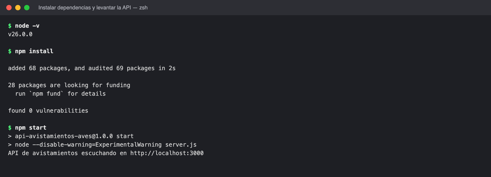

POST /avistamientos → 201 Created:

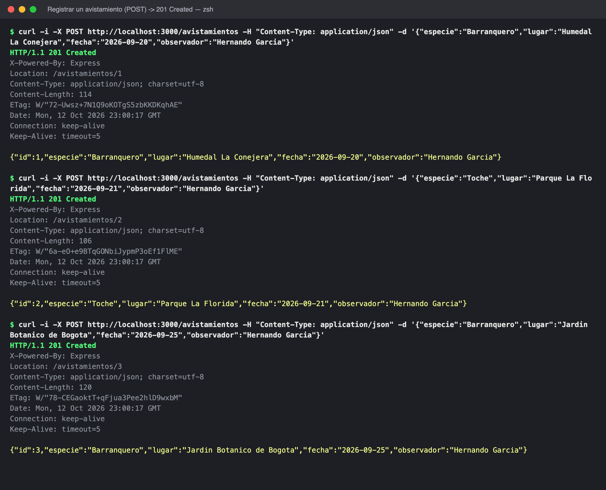

POST /avistamientos con datos faltantes o fecha inválida → 400 Bad Request:

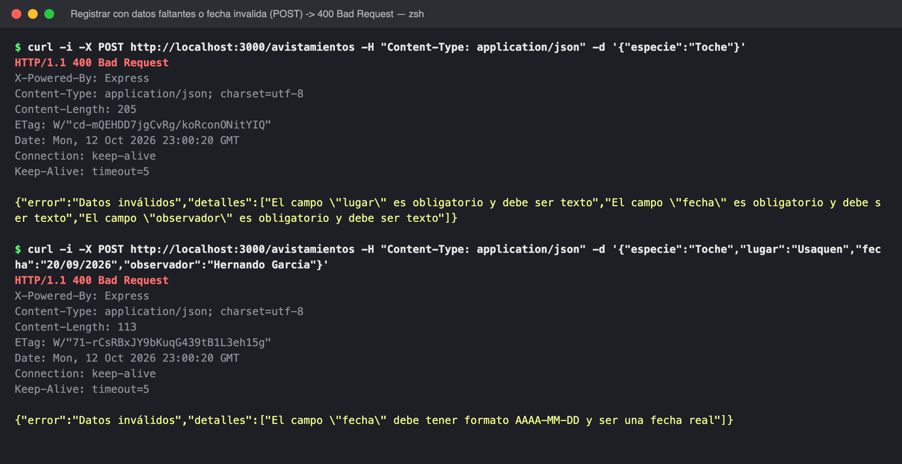

GET /avistamientos → 200 OK:

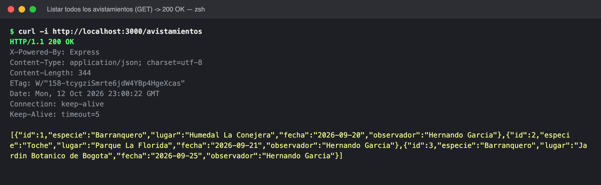

GET /avistamientos/{id} → 200 OK:

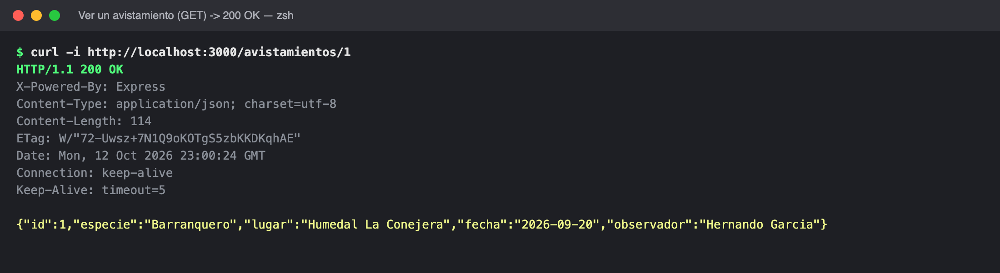

GET /avistamientos/{id} inexistente → 404 Not Found:

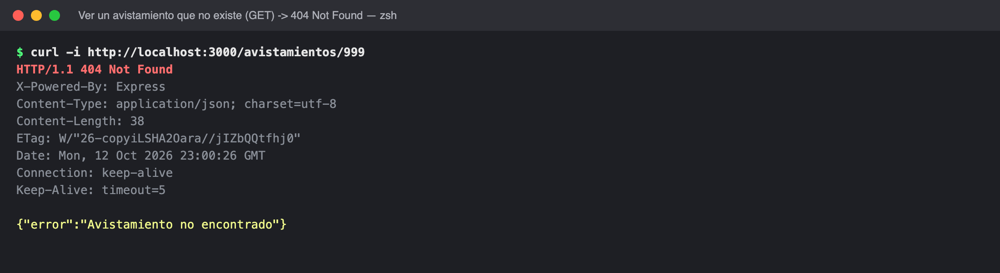

PUT /avistamientos/{id} → 200 OK:

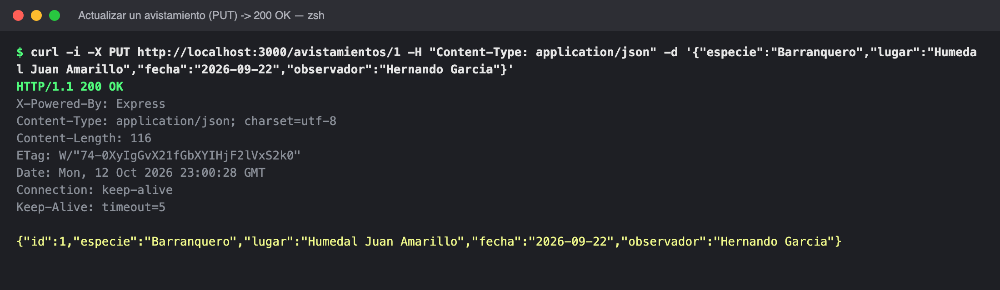

PUT /avistamientos/{id} inexistente → 404, y con datos faltantes → 400:

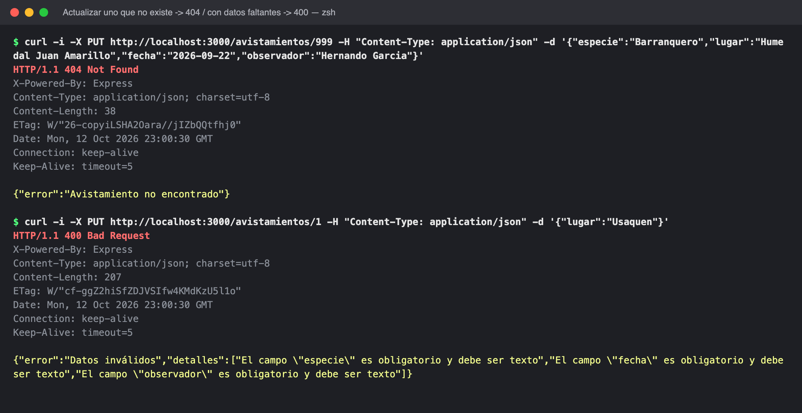

GET /avistamientos/resumen (bonus) → 200 OK:

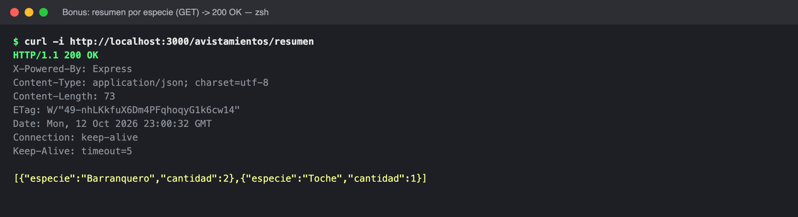

DELETE /avistamientos/{id} → 204 No Content, y otra vez → 404:

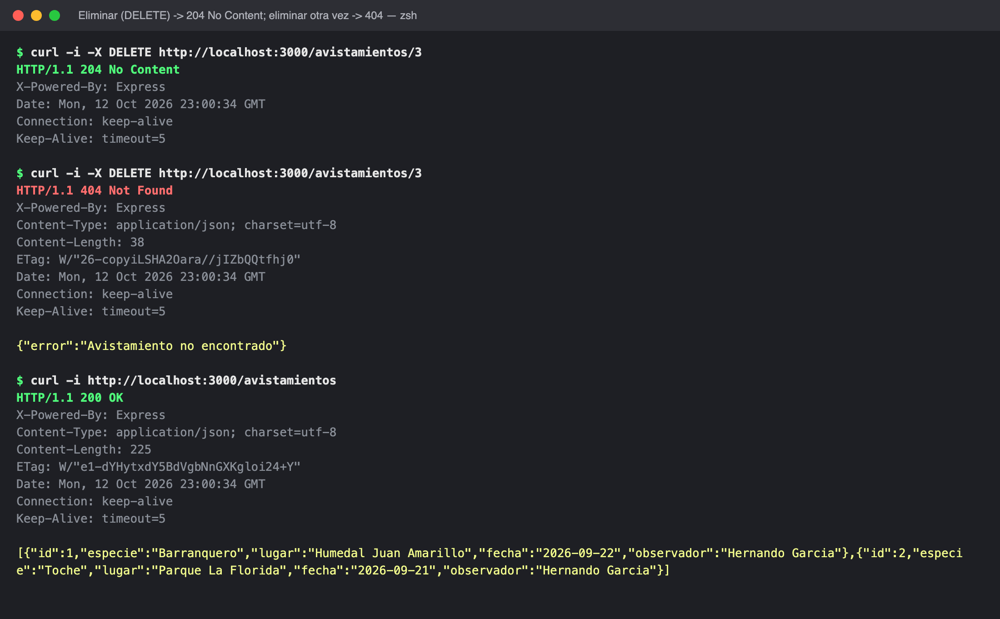

Pruebas de integración (`npm test`), 13 de 13 pasan:

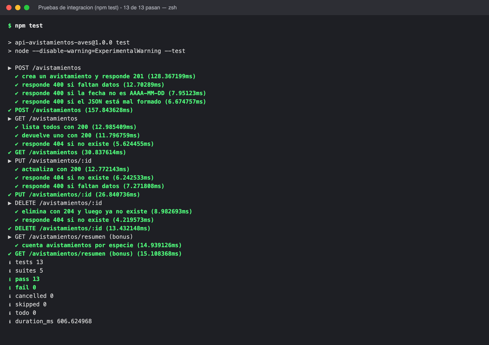

## Estructura

```
server.js            Punto de entrada (abre la base y levanta el servidor)
src/app.js           Rutas y códigos de estado
src/repositorio.js   Consultas SQL
src/validacion.js    Validación de datos del avistamiento
src/db.js            Conexión a SQLite y creación de la tabla
test/api.test.js     Pruebas de integración
capturas/            Capturas de la API funcionando
postman_collection.json  Colección para importar en Postman
```

## Uso de inteligencia artificial y referencias

- Se usó Claude (Anthropic), modelo Claude Opus 5.5, como apoyo para generar la estructura del código, las pruebas y este README. El código fue revisado, probado y entendido por el autor.
- Documentación consultada: Express (https://expressjs.com) y el módulo `node:sqlite` de Node.js (https://nodejs.org/api/sqlite.html).
