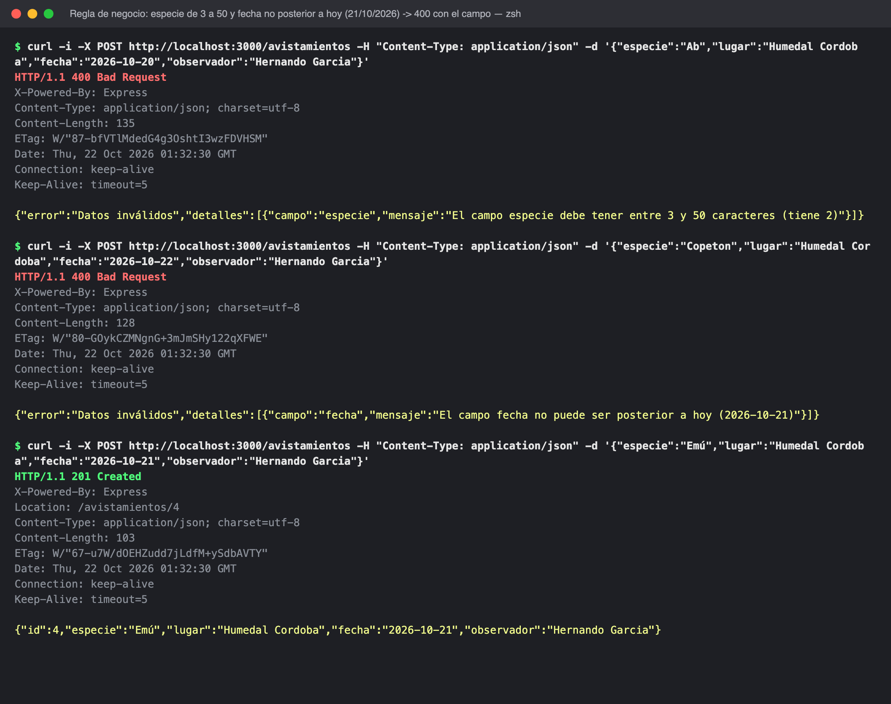
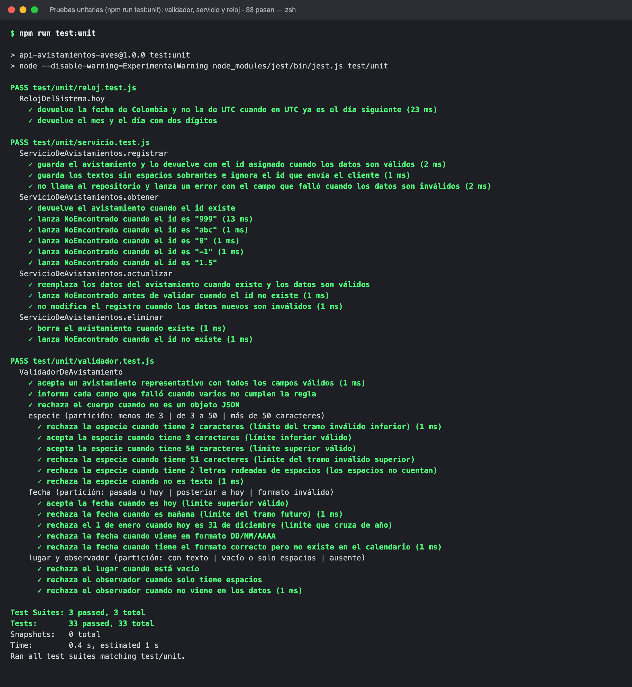
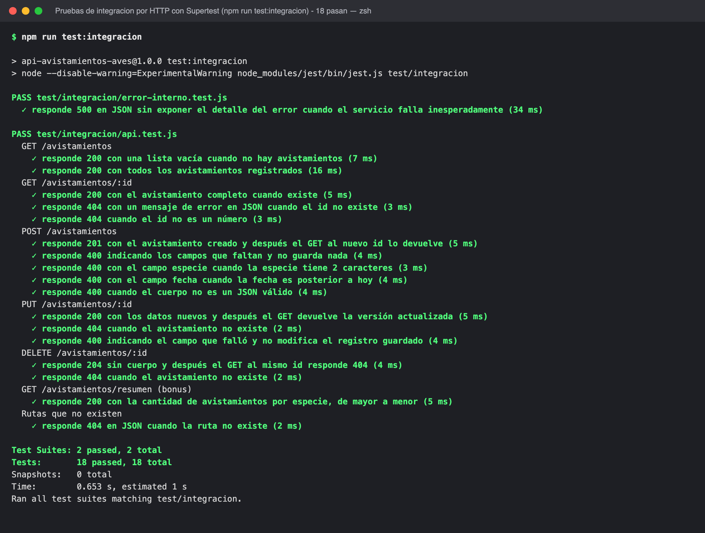
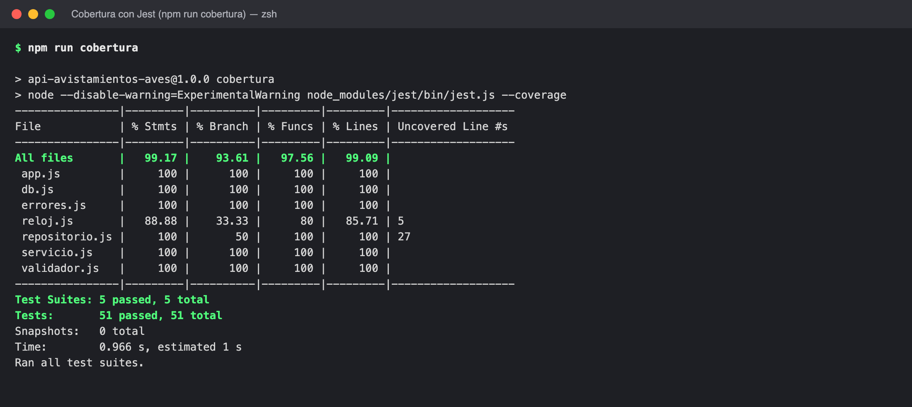
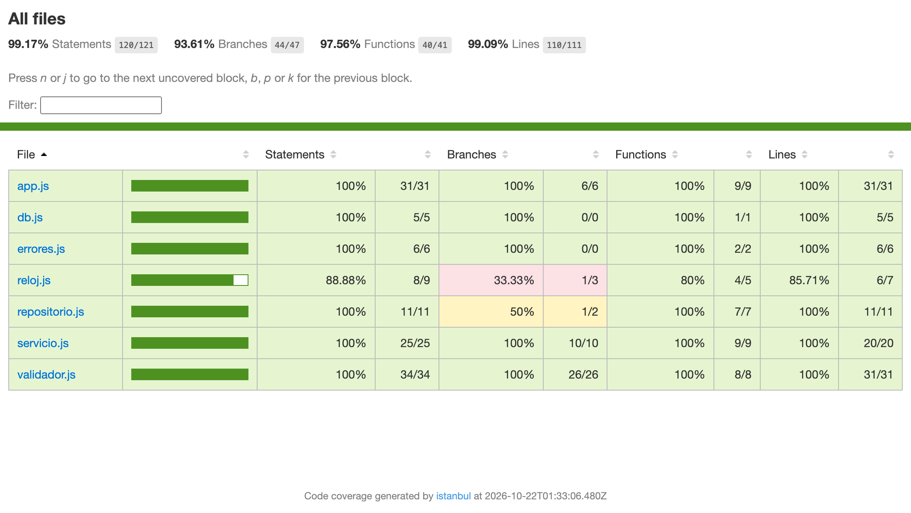
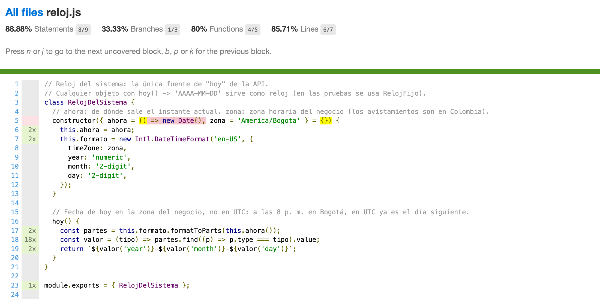
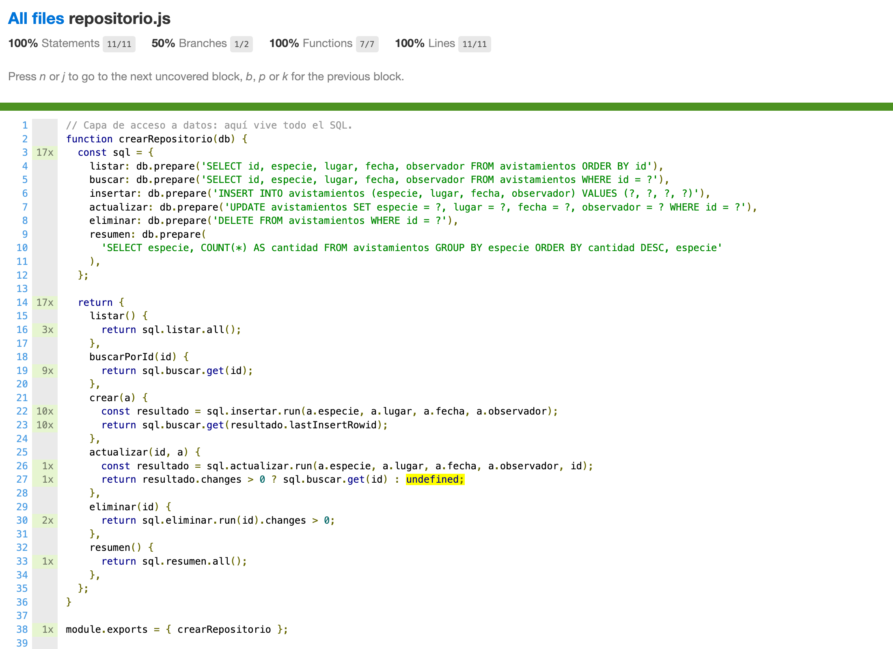

# API REST de avistamientos de aves

Trabajo en clase de Ingeniería de Software 2 (ISW-2), Universidad El Bosque.
Autor: Hernando Javier García Mogollón.

- Sesión 17 (29 de septiembre): construir la API REST.
- Sesión 22 (21 de octubre): taller de pruebas unitarias y de integración sobre la misma API. La justificación de las decisiones de pruebas está en [`docs/justificacion-pruebas.md`](docs/justificacion-pruebas.md) (también en PDF: [`docs/justificacion-pruebas.pdf`](docs/justificacion-pruebas.pdf)).

API REST para registrar avistamientos de aves. Recibe y responde JSON y guarda los datos en SQLite con el módulo integrado `node:sqlite` de Node.js.

## Tecnologías

- Node.js 22.13 o superior (trae `node:sqlite` integrado, no hay que instalar SQLite aparte)
- Express 5
- Jest 30 (pruebas unitarias, dobles de prueba y cobertura) y Supertest 7 (pruebas de la API por HTTP)

## Instalación y ejecución

Funciona igual en macOS, Windows y Linux.

1. Instalar Node.js 22.13 o superior desde https://nodejs.org (versión LTS) y verificar:

```bash
node -v
```

2. Clonar el repositorio e instalar dependencias:

```bash
git clone https://github.com/Nandoski666/ApiRestFuncional.git
cd ApiRestFuncional
npm install
```

3. Levantar la API:

```bash
npm start
```

La API queda en `http://localhost:3000`. La base de datos se crea sola en el archivo `avistamientos.db`.
Para usar otro puerto: `PORT=4000 npm start` (en PowerShell: `$env:PORT=4000; npm start`).

## Modelo del recurso

```json
{
  "id": 1,
  "especie": "Barranquero",
  "lugar": "Humedal La Conejera",
  "fecha": "2026-09-20",
  "observador": "Hernando Garcia"
}
```

El `id` lo asigna el sistema.

### Regla de negocio

Un avistamiento es válido si:

- la `especie` tiene entre 3 y 50 caracteres (sin contar los espacios de los extremos);
- la `fecha` tiene el formato AAAA-MM-DD, es una fecha real y no es posterior a hoy (hoy en hora de Colombia, `America/Bogota`);
- el `lugar` y el `observador` no están vacíos.

Si no es válido, POST y PUT responden 400 indicando qué campo falló. La regla vive en la clase `ValidadorDeAvistamiento` (`src/validador.js`), separada del controlador.

## Endpoints

| Método | Ruta | Descripción | Respuestas |
|---|---|---|---|
| GET | /avistamientos | Listar todos | 200 |
| GET | /avistamientos/{id} | Ver uno | 200, 404 |
| POST | /avistamientos | Registrar | 201, 400 |
| PUT | /avistamientos/{id} | Actualizar | 200, 400, 404 |
| DELETE | /avistamientos/{id} | Eliminar | 204, 404 |
| GET | /avistamientos/resumen | Cantidad por especie (bonus) | 200 |

Los errores responden JSON. Un 404:

```json
{"error": "Avistamiento no encontrado"}
```

Un 400 dice qué campo falló:

```json
{
  "error": "Datos inválidos",
  "detalles": [
    {"campo": "especie", "mensaje": "El campo especie debe tener entre 3 y 50 caracteres (tiene 2)"},
    {"campo": "fecha", "mensaje": "El campo fecha no puede ser posterior a hoy (2026-10-21)"}
  ]
}
```

## Ejemplos con curl

En Windows se pueden ejecutar en Git Bash, o importar en Postman el archivo `postman_collection.json`.

Registrar (201):

```bash
curl -i -X POST http://localhost:3000/avistamientos \
  -H "Content-Type: application/json" \
  -d '{"especie":"Barranquero","lugar":"Humedal La Conejera","fecha":"2026-09-20","observador":"Hernando Garcia"}'
```

Registrar con datos faltantes (400):

```bash
curl -i -X POST http://localhost:3000/avistamientos \
  -H "Content-Type: application/json" \
  -d '{"especie":"Toche"}'
```

Registrar con una regla de negocio incumplida (400 indicando el campo; la fecha no puede ser posterior a hoy):

```bash
curl -i -X POST http://localhost:3000/avistamientos \
  -H "Content-Type: application/json" \
  -d '{"especie":"Ab","lugar":"Humedal Cordoba","fecha":"2099-01-01","observador":"Hernando Garcia"}'
```

Listar todos (200):

```bash
curl -i http://localhost:3000/avistamientos
```

Ver uno (200, o 404 si no existe):

```bash
curl -i http://localhost:3000/avistamientos/1
curl -i http://localhost:3000/avistamientos/999
```

Actualizar (200, o 404 si no existe):

```bash
curl -i -X PUT http://localhost:3000/avistamientos/1 \
  -H "Content-Type: application/json" \
  -d '{"especie":"Barranquero","lugar":"Jardin Botanico de Bogota","fecha":"2026-09-22","observador":"Hernando Garcia"}'
```

Eliminar (204, o 404 si no existe):

```bash
curl -i -X DELETE http://localhost:3000/avistamientos/1
```

Resumen por especie (200):

```bash
curl -i http://localhost:3000/avistamientos/resumen
```

Respuesta de ejemplo:

```json
[{"especie":"Barranquero","cantidad":2},{"especie":"Toche","cantidad":1}]
```

## Pruebas y cobertura

| Qué | Comando |
|---|---|
| Todas las pruebas (51) | `npm test` |
| Solo las unitarias (33) | `npm run test:unit` |
| Solo las de integración (18) | `npm run test:integracion` |
| Cobertura | `npm run cobertura` |

```bash
npm test
```

```bash
npm run cobertura
```

`npm run cobertura` imprime la tabla de cobertura en la terminal y genera el reporte HTML en `coverage/index.html`.

Las pruebas están en la carpeta `test/`:

- `test/unit/`: pruebas unitarias, sin Express ni base de datos.
  - `validador.test.js`: la regla de negocio, con partición de equivalencia y valores límite (especie de 2, 3, 50 y 51 caracteres; fecha de hoy y de mañana).
  - `servicio.test.js`: el servicio con un repositorio en memoria (fake) y spies.
  - `reloj.test.js`: el reloj del sistema (fecha de Colombia y no de UTC).
- `test/integracion/`: los cinco endpoints y el resumen a través de HTTP con Supertest. Usan la base SQLite real en memoria, una nueva por cada prueba, y verifican el código, el cuerpo y el efecto (por ejemplo, que después del DELETE el GET responda 404).
- `test/dobles/`: los dobles de prueba `RelojFijo` (stub) y `RepositorioEnMemoria` (fake).

La tabla de casos, los dobles, lo que no se probó y la lectura de la cobertura están explicados en [`docs/justificacion-pruebas.md`](docs/justificacion-pruebas.md).

Nota: `npm install` muestra advertencias moderadas de `npm audit`. Vienen de dependencias internas de Jest (solo de desarrollo). Las dependencias de la API en producción no tienen vulnerabilidades (`npm audit --omit=dev`).

## Capturas de funcionamiento

Salidas reales de la API corriendo en local (carpeta [`capturas/`](capturas)).

Instalar y levantar la API:


POST /avistamientos → 201 Created:


POST /avistamientos con datos faltantes o fecha inválida → 400 Bad Request:


GET /avistamientos → 200 OK:


GET /avistamientos/{id} → 200 OK:


GET /avistamientos/{id} inexistente → 404 Not Found:


PUT /avistamientos/{id} → 200 OK:


PUT /avistamientos/{id} inexistente → 404, y con datos faltantes → 400:


GET /avistamientos/resumen (bonus) → 200 OK:


DELETE /avistamientos/{id} → 204 No Content, y otra vez → 404:


Regla de negocio: especie de 2 caracteres → 400 (`especie`), fecha de mañana → 400 (`fecha`), fecha de hoy → 201. Se tomó a las 8:32 p. m. del 21 de octubre en Bogotá, cuando en UTC ya era 22:



Pruebas unitarias (`npm run test:unit`), 33 pasan:



Pruebas de integración (`npm run test:integracion`), 18 pasan:



Cobertura (`npm run cobertura`):





Ramas sin cubrir que se analizan en el documento de justificación:





## Estructura

```
server.js                     Punto de entrada: arma las piezas y levanta el servidor
src/app.js                    Rutas (controlador): traduce HTTP <-> servicio y errores -> 400/404/500
src/servicio.js               ServicioDeAvistamientos: casos de uso (recibe repositorio y validador)
src/validador.js              ValidadorDeAvistamiento: la regla de negocio
src/reloj.js                  RelojDelSistema: la fecha de hoy en hora de Colombia
src/errores.js                ErrorDeValidacion y NoEncontrado
src/repositorio.js            Consultas SQL
src/db.js                     Conexión a SQLite y creación de la tabla
test/unit/                    Pruebas unitarias
test/integracion/             Pruebas de integración por HTTP (Supertest)
test/dobles/                  RelojFijo (stub) y RepositorioEnMemoria (fake)
docs/                         Documento de justificación del taller de pruebas (Markdown y PDF)
capturas/                     Capturas de la API, las pruebas y la cobertura
postman_collection.json       Colección para importar en Postman
```

## Uso de inteligencia artificial y referencias

- Se usó Claude (Anthropic), modelo Claude Opus 5.5, como apoyo para generar la estructura del código, la refactorización para el taller de pruebas, las pruebas, el documento de justificación y este README. El código fue revisado, probado y entendido por el autor.
- Documentación consultada: Express (https://expressjs.com), el módulo `node:sqlite` de Node.js (https://nodejs.org/api/sqlite.html), Jest (https://jestjs.io) y Supertest (https://github.com/ladjs/supertest).
- Conceptos de pruebas: presentación de la Sesión 20 de ISW-2 (partición, valores límite, AAA, FIRST y los cinco dobles), Myers (1979) y Meszaros (2007).
